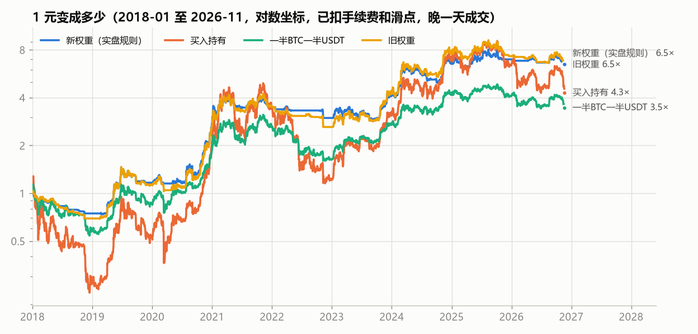
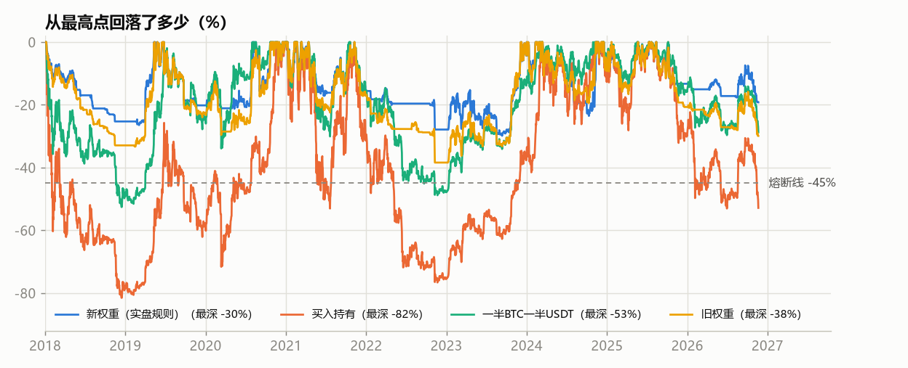
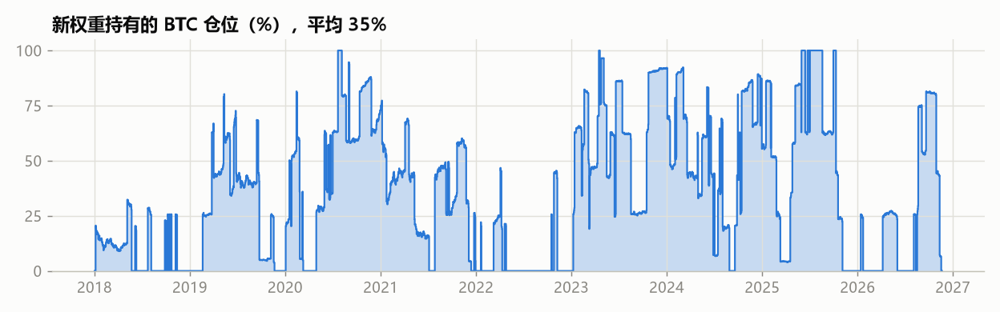
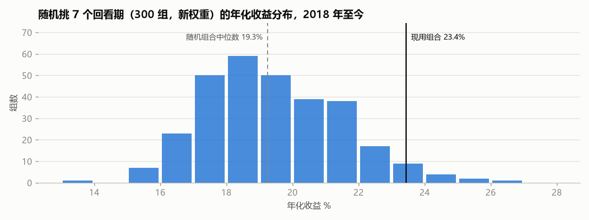

# BTC 现货趋势规则：独立回测复核报告

生成日期 2026-11-21｜数据截至 2026-11-20（UTC 日线）｜由 `python backtest/run_all.py` 自动生成，所有数字都能重跑复现

> 这是研究记录，不是投资建议。回测是对过去的统计，未来可能完全不同。

两个名词：**旧权重** = 评审最初的提案，仓位 = 上涨的回看期个数 ÷ 7 × V。**新权重** = 2026-11-21 起默认采用、脚本实盘使用的版本，仓位 = max(0, 上涨个数 − 0.3 × 下跌个数) ÷ 7 × V（上涨 0–7 个时分别是 0、0、0.07、0.26、0.44、0.63、0.81、1，再乘 V）。其余完全相同。

## 一页结论

1. **评审报的旧权重数字：收益对，回撤略偏乐观。** 用评审自己的代码重跑，结果和它一样（2018 年至今年化 25.0%（收盘成交）/ 22.6%（晚一天成交），最大回撤约 35%）。按真实账户方式重写后（现货手续费 0.1% + 滑点 0.05%，仓位随价格漂移）：年化 24.9% / 23.3%，最大回撤 **38%**，比评审说的多 3 个点左右。
2. **新权重：「回撤更小」能复现，「收益更高」复现不出来。** 提案报告说年化 23.1% → 27.3%、最大回撤 37.3% → 27.2%。我的结果（2018 年至今）：
   - 最大回撤：旧 36%–38% → 新 **28%–32%**（三个数据源、各种成交时点全都下降，少 4–10 个点）。这一半成立。
   - 年化：收盘成交 24.9% → 26.3%；收盘后 1 小时成交 25.2% → 25.6%；晚一天成交 23.3% → 23.4%。各种数据源和成交时点下，新减旧在 -1.4 到 +1.9 个点之间，**基本持平**，不是提高 4 个点。
   - 换成随机的 7 个回看期（300 组）：新权重收益更高的只占 33%（中位数 -0.9 个点），回撤更小的占 76%（中位数 -2.6 个点）。在 300 条模拟的未来路径上：年化中位数 17% → 17%，回撤更小的路径占 82%。
   - **结论**：新权重本质是「平均仓位从 42% 降到 35%、意见不统一时少拿」，换来回撤小几个点、收益大致不变。这和「少亏」的目标一致，可以用；但不要指望它多赚，现用回看期上 4–10 个点的回撤改善也偏幸运（换成随机回看期，典型只有 3 个点左右）。已设为默认实盘规则，旧权重作为影子账并行记录 6–12 个月。
3. **历史数字不能当作对未来的预期。** ① 现用的 7 个回看期在随机 300 组里年化排第 96 百分位（随机组合中位数只有 19.3% / 回撤 36%），带有运气；② 2018 年以来的利润有 68% 来自最好的那 12 个月；③ 2022 年以来年化只有 13.6%。
4. **合理预期：年化大约 10–20%，任意 3 年亏钱的可能约 1/4 到 1/3，账面回撤要按 -45% 到 -50% 做准备，可能连续两三年不创新高。** 把比特币历史价格按段打乱重排成 300 条「未来 3 年」的路径再跑新权重：若比特币今后年化 8%，规则年化中位数 17%、3 年亏钱概率 23%；若比特币不涨，中位数 13%、亏钱概率 26%；趋势被打得更碎时（每段 30 天）中位数只有 7%、亏钱概率 37%。最差 5% 的路径回撤 37%–49%。历史上最长连续 965 天（约 2.6 年）没创新高；现在距 2025-08-13 的高点已回落 19%。
5. **这套规则的价值是「少亏」，不是「多赚」。** 同样 110U 起步、每 30 天存 50U、持有 3 年（95 个不同起点）：「存入就买、一直持有」期末是投入的 2.13 倍（中位数），新权重 1.71 倍；但过程中最深的账面浮亏，持有是 -58%，新权重是 -19%。规则只在 20% 的起点上最终比定投赚得多。如果能扛住账面 -60% 不割肉，每月定投并持有更简单，历史上钱也更多；选这套规则是为了跌的时候拿得住。
6. **其余参数不用改。** 回看期、波动率目标（30%/40%/50%）、调仓门槛（0.1–0.3）、扣减系数（0.2–1.0）、成交延迟（0–24 小时）左右挪动，结果都在同一范围；对手续费和下单时间不敏感。
7. **-45% 熔断在历史上从未触发**（新权重历史最大回撤 30%），它是「规则可能失效了」的警报，不是日常风控；收紧会伤害收益，不要收紧。
8. **没有验证的**：未来趋势效应是否延续；USDT 脱锚、欧易平台风险；实盘成交（没有 API key，下单流程只用模拟对象测过）。

## 1. 数据与方法

| 数据源 | 范围 | 天数 | 缺口 | 用途 |
|---|---|---|---|---|
| Yahoo BTC-USD 日线 | 2014-09-17 ~ 2026-11-20 | 4448 | 0 | 主回测（和评审同源，便于对比）|
| Bitstamp BTC/USD 日线 | 2014-01-01 ~ 2026-11-20 | 4707 | 0 | 第二数据源交叉核对 |
| OKX BTC-USDT 日线 | 2018-01-11 ~ 2026-11-20 | 3236 | 0 | 实际交易的市场（2018-01-11 之前用 Bitstamp 补历史）|
| Binance BTCUSDT 小时线 | 2017-08 起 | — | — | 测试「收盘后晚 N 小时成交」|

- Yahoo 缺 2026-11-20 这一天，用 Bitstamp 补上（评审当时用的是 Kraken）。
- 各源收盘价的差异：OKX 对 Bitstamp（2020 年以来）中位数 0.046%、99% 分位 0.47%、最大 1.25%；Yahoo 对 OKX 中位数 0.082%、最大 4.71%（Yahoo 是聚合价，个别日子偏差大，而且会缺最近一天，所以**实盘脚本不用 Yahoo**，用 OKX 并以 Binance/Kraken 等交叉核对）。
- 回测方式：模拟真实账户里的 USDT 和 BTC 数量；每天 UTC 收盘后用**和实盘脚本同一份代码**算信号、判断是否调仓；买卖按成交价加减滑点并扣手续费；仓位随价格自然漂移。
- 成本假设：手续费 0.10%（欧易普通用户现货吃单费率，官方 2026-07 公告；部分地区是 0.2%/0.35%，见 5.5 节）+ 滑点 0.05%。
- 「晚一天成交」= 信号出来后等到下一个收盘价才成交，最保守；实盘是收盘后约 22 分钟成交，介于「收盘成交」和「1 小时后成交」之间。
- 除第 9 节外，表里都没有开熔断（历史上 -45% 从未触发，开不开结果一样）。

## 2. 复核评审的数字（旧权重）

| 2018-01 至 2026-11-20 | 年化 / 最大回撤（收盘成交）| 年化 / 最大回撤（晚一天成交）|
|---|---|---|
| 评审报告的数字 | 25.0% / 35% | 22.6% / 35% |
| 用评审的代码在新数据上重跑（手续费 0.05%）| 25.0% / 35% | 22.6% / 35% |
| 同上，手续费改为现货的 0.1% | 24.7% / 35% | 22.3% / 35% |
| **本报告的账户级回测，旧权重（0.1% + 滑点 0.05%）** | **24.9% / 38%** | **23.3% / 38%** |

差别来自三处：评审用的是合约的 0.05% 手续费（现货是 0.1%）；它假设仓位每天免费回到目标比例、调仓门槛是拿「新目标」和「上次目标」比，而真实账户里仓位会随价格漂移、门槛是拿目标和**实际仓位**比（脚本就是这么做的）；它的波动率用普通收益率而不是对数收益率。收益几乎不受影响，回撤多了约 3 个点。

## 3. 新权重对旧权重

每格是 年化 / 最大回撤，2018-01 至 2026-11-20，0.1% + 0.05% 成本：

| 数据 / 成交时点 | 旧权重 | 新权重 | 年化变化（点）| 回撤变化（点）|
|---|---|---|---|---|
| Yahoo，收盘成交 | 24.9% / 38% | 26.3% / 28% | +1.4 | -10 |
| Yahoo，晚一天 | 23.3% / 38% | 23.4% / 30% | +0.1 | -9 |
| Bitstamp，收盘成交 | 26.1% / 37% | 24.8% / 32% | -1.4 | -4 |
| Bitstamp，晚一天 | 23.7% / 38% | 22.9% / 32% | -0.8 | -6 |
| OKX，收盘成交 | 24.3% / 37% | 26.2% / 30% | +1.9 | -7 |
| OKX，晚一天 | 23.0% / 38% | 21.7% / 32% | -1.3 | -6 |
| Binance 小时线，收盘后 0 小时 | 25.7% / 37% | 25.7% / 30% | +0.0 | -7 |
| Binance 小时线，收盘后 1 小时 | 25.2% / 36% | 25.6% / 29% | +0.4 | -8 |
| Binance 小时线，收盘后 24 小时 | 23.3% / 38% | 22.8% / 32% | -0.6 | -6 |
| 提案报告的数字 | 23.1% / 37% | 27.3% / 27% | +4.2 | -10 |
| 提案报告，晚 24 小时 | 22.8% / 38% | 23.5% / 29% | +0.7 | -9 |

- 晚一天成交的数字和提案报告吻合；收盘成交的「+4.2 个点」在我这里是 -1.4 到 +1.9（四种数据），没有复现。
- 夏普比率 0.89 → 0.95（统计误差约 ±0.40，这点差别在误差之内）；平均仓位 42% → 35%；每年调仓 18 → 20 次。
- 2022 年起（晚一天成交）：旧 14.0% / 30% → 新 13.6% / 24%。

分段看（Yahoo，晚一天成交）：

| 区间 | 旧权重 | 新权重 |
|---|---|---|
| 2018–2020 | 38.8% / 33% | 40.3% / 26% |
| 2021–2023 | 14.2% / 38% | 13.2% / 30% |
| 2024–2026 | 13.6% / 30% | 15.0% / 24% |

扣减系数（现用 0.3）挪一挪，Yahoo，晚一天成交：

| 系数 | 0.0（旧） | 0.1 | 0.2 | 0.3（现用） | 0.4 | 0.5 | 0.7 | 1.0 | 1.5 |
|---|---|---|---|---|---|---|---|---|---|
| 2018 年起 | 23.3% / 38% | 21.9% / 39% | 23.8% / 32% | 23.4% / 30% | 22.1% / 27% | 22.4% / 26% | 23.0% / 25% | 21.8% / 22% | 19.8% / 22% |
| 2022 年起 | 14.0% / 30% | 13.7% / 25% | 13.5% / 23% | 13.6% / 24% | 14.5% / 27% | 14.9% / 24% | 14.3% / 20% | 13.4% / 20% | 11.7% / 21% |
| 平均仓位 | 42% | 39% | 37% | 35% | 33% | 32% | 30% | 27% | 24% |

- 系数越大仓位越低、回撤越小，收益缓慢下降：它是一个「降仓位」的旋钮，0.2–1.0 之间没有哪个值特别突出，0.3 不是挑出来的尖峰。

换成随机的 7 个回看期（10–365 天里随机挑，300 组），每组都分别用新旧权重跑一遍（2018 年起，晚一天成交）：

| | 5% 分位 | 中位数 | 95% 分位 |
|---|---|---|---|
| 年化：新 − 旧（点）| -4.2 | -0.9 | +2.0 |
| 最大回撤：新 − 旧（点，负数 = 回撤更小）| -8.8 | -2.6 | +3.4 |

- 新权重年化更高的组占 33%，回撤更小的占 76%，夏普更高的占 52%。
- 现用回看期在新权重下：年化排在随机组合的第 96 百分位，回撤比 98% 的随机组合都小（旧权重下年化排第 90 百分位）。也就是说「现用回看期 + 0.3」这个组合在这段历史上尤其顺，典型的改善要小得多。
- 以太坊（参数不动）：2018-08 起 旧 19.9% / 43% → 新 25.3% / 39%；2022 年起 旧 -3.0% / 43% → 新 4.8% / 30%。方向一致（以太坊与比特币高度相关，不算独立证据）。
- 模拟的未来路径上的对比见第 7 节。

**复核结论**：新权重在所有测试里回撤都不比旧权重差，多数更好；收益大致不变（略低的时候多于略高的时候）。提案里「年化提高 4 个点」不成立，「回撤降 10 个点」只在现用回看期上成立。它是一个温和的降风险改动，不构成反对采用的理由，但预期应当是「回撤小几个点」，不是「又多赚又少亏」。

## 4. 基准结果（新权重）

年化 / 最大回撤（按日收盘计）：

| 区间 | 数据 | 收盘成交 | 晚一天成交 | 买入持有 | 一半BTC一半USDT |
|---|---|---|---|---|---|
| 2015-10 起 | Yahoo | 51.3% / 33% | 47.5% / 33% | 64.0% / 83% | 36.7% / 56% |
| 2015-10 起 | Bitstamp | 48.4% / 32% | 45.4% / 36% |  |  |
| 2018-01 起 | Yahoo | 26.3% / 28% | 23.4% / 30% | 17.8% / 82% | 15.0% / 53% |
| 2018-01 起 | Bitstamp | 24.8% / 32% | 22.9% / 32% |  |  |
| 2018-01 起 | OKX | 26.2% / 30% | 21.7% / 32% |  |  |
| 2020-01 起 | Yahoo | 31.6% / 28% | 28.3% / 30% | 35.6% / 77% | 22.0% / 49% |
| 2020-01 起 | Bitstamp | 28.7% / 32% | 26.4% / 32% |  |  |
| 2020-01 起 | OKX | 30.2% / 30% | 25.3% / 32% |  |  |
| 2022-01 起 | Yahoo | 18.6% / 22% | 13.6% / 24% | 4.4% / 67% | 5.8% / 39% |
| 2022-01 起 | Bitstamp | 18.2% / 23% | 12.9% / 24% |  |  |
| 2022-01 起 | OKX | 18.5% / 23% | 13.1% / 24% |  |  |

- 收盘后 1 小时成交（Binance 小时线）：2018 年起 25.6% / 29%，2022 年起 17.5% / 23%。
- 2018 年起（晚一天成交）：夏普比率 0.95（统计误差约 ±0.40，也就是说「真实值是 0.6 还是 1.3」这段历史分不清）；年化波动 26%；平均仓位 35%，有持仓的天数占 72%；每年调仓约 20 次，年换手 5.3 倍；按盘中最低价算的最大回撤 30%。
- 2015–2017 的数字来自比特币从几百美元涨到两万的阶段，不应外推。







分年收益（Yahoo，晚一天成交）：

| 年份 | 2018 | 2019 | 2020 | 2021 | 2022 | 2023 | 2024 | 2025 | 2026 |
|---|---|---|---|---|---|---|---|---|---|
| 新权重 | -25% | 56% | 137% | 26% | -15% | 37% | 60% | 6% | -7% |
| 旧权重 | -31% | 62% | 137% | 31% | -26% | 62% | 79% | -4% | -12% |
| 买入持有 | -73% | 92% | 303% | 60% | -64% | 155% | 121% | -6% | -33% |

任意起点持有一段时间的年化收益（新权重，2018 年起，每周取一个起点）：

| | 最差 | 中位数 | 最好 | 亏钱的起点占比 |
|---|---|---|---|---|
| 新权重，持有 1 年 | -25% | 17% | 259% | 34% |
| 买入持有，持有 1 年 | -74% | 38% | 1033% | 36% |
| 新权重，持有 3 年 | 6% | 33% | 74% | 0% |
| 买入持有，持有 3 年 | -2% | 39% | 147% | 1% |

注意：这些 3 年窗口互相重叠，其实只覆盖约 3 轮牛熊，「历史上 3 年几乎没亏过」的说服力有限，见第 7 节的模拟。

## 5. 稳健性：参数挪一挪结果变不变（新权重）

全部用 Yahoo 数据、晚一天成交、0.1% + 0.05% 成本；每格是 年化 / 最大回撤。

### 5.1 回看期

| 回看期组合 | 2018 年起 | 2022 年起 |
|---|---|---|
| 现用 {20,40,60,90,120,180,240} | 23.4% / 30% | 13.6% / 24% |
| 评审备选 {30,60,90,180,365} | 18.4% / 40% | 20.4% / 22% |
| 12 个回看期 {10…365} | 20.1% / 34% | 14.3% / 19% |
| 只用短期 {20,40,60} | 24.1% / 45% | 12.0% / 38% |
| 只用长期 {120,180,240} | 19.2% / 42% | 14.0% / 30% |
| 现用 ×0.75 | 22.2% / 38% | 12.7% / 25% |
| 现用 ×1.25 | 20.6% / 33% | 13.2% / 22% |
| 现用 ×1.5 | 19.6% / 32% | 17.0% / 27% |
| 单个回看期 20 | 21.9% / 54% | 5.2% / 45% |
| 单个回看期 60 | 22.3% / 51% | 11.3% / 44% |
| 单个回看期 120 | 21.7% / 42% | 13.1% / 37% |
| 单个回看期 240 | 25.4% / 43% | 16.8% / 43% |
| 单个回看期 365 | 20.7% / 54% | 23.7% / 31% |

- 从现用 7 个里去掉任意 1 个：年化 18.7% ~ 24.4%，最大回撤 30% ~ 38%。
- 随机挑 7 个回看期 300 次：年化的 5%/25%/50%/75%/95% 分位是 16.4% / 17.8% / 19.3% / 21.0% / 23.3%，最大回撤分位 31% / 34% / 36% / 39% / 44%。现用组合的年化排在第 **96** 百分位（2022 年起排第 30 百分位，随机中位数 15.1%）。
- 结论：多个回看期合在一起比单个稳（单个回看期的回撤是 42%–54%）；现用这组在这段历史上偏幸运，比随机组合的中位数高约 4 个点，对未来应按中位数（约 19%）甚至更低来想。



### 5.2 波动率目标与窗口

| 波动率目标 | 2018 年起 | 2022 年起 | 平均仓位 |
|---|---|---|---|
| 30% | 19.8% / 27% | 13.0% / 21% | 29% |
| 40%（现用） | 23.4% / 30% | 13.6% / 24% | 35% |
| 50% | 26.1% / 38% | 17.3% / 26% | 40% |
| 60% | 25.8% / 42% | 15.0% / 24% | 42% |
| 不用（只看趋势） | 21.1% / 58% | 13.6% / 26% | 46% |

| 波动率窗口（天）| 20 | 30（现用） | 45 | 60 | 90 |
|---|---|---|---|---|---|
| 2018 年起 | 21.1% / 35% | 23.4% / 30% | 27.3% / 27% | 28.7% / 25% | 25.1% / 29% |

- 波动率目标的作用是**降仓位、降回撤**（不用它回撤是 58%），不是提高收益；30%/40%/50% 是「收益换回撤」的旋钮，没有哪个明显更优。
- 波动率窗口 20–90 天，年化在 21%–29% 之间。45–60 天在这段历史上数字更好看，但在旧权重下各窗口都在 20%–24% 之间、没有这个差别，属于噪声，不据此改参数。

### 5.3 调仓门槛

| 门槛 | 2018 年起 | 2022 年起 | 每年调仓次数 |
|---|---|---|---|
| 0.0 | 21.7% / 31% | 13.1% / 23% | 279 |
| 0.1 | 21.6% / 32% | 13.6% / 23% | 63 |
| 0.15 | 22.7% / 32% | 13.6% / 23% | 41 |
| 0.2（现用） | 23.4% / 30% | 13.6% / 24% | 20 |
| 0.25 | 25.0% / 30% | 18.1% / 21% | 14 |
| 0.3 | 22.4% / 35% | 15.8% / 23% | 10 |
| 0.4 | 28.8% / 33% | 11.3% / 31% | 6 |

- 门槛从 0.1 到 0.3，年化在 22%–25% 之间无规律地跳，属于噪声。它的实际好处是把每年 279 次调仓降到约 20 次，适合小账户。

### 5.4 成交延迟（收盘后晚几个小时才成交）

| 延迟 | 0 小时 | 1 小时 | 2 小时 | 4 小时 | 8 小时 | 12 小时 | 16 小时 | 24 小时 |
|---|---|---|---|---|---|---|---|---|
| 2018 年起 | 25.7% / 30% | 25.6% / 29% | 24.6% / 29% | 24.8% / 29% | 24.4% / 29% | 24.7% / 29% | 23.7% / 29% | 22.8% / 32% |
| 2022 年起 | 18.5% / 23% | 17.5% / 23% | 17.1% / 23% | 17.5% / 23% | 17.0% / 23% | 16.8% / 22% | 13.8% / 24% | 13.2% / 24% |

- 收盘后 0–12 小时内成交，差别很小（2018 年起年化 24%–26%，2022 年起 17%–18%）。拖到 16–24 小时会差一些（2018 年起 23%–24%，2022 年起 13%–14%）。
- 所以：哪天因为故障晚跑几个小时不要紧，不必手动干预；但不要习惯性地拖到第二天。本报告其他表格用的「晚一天成交」是偏保守的假设。

### 5.5 手续费与滑点

| 手续费 + 滑点（每笔）| 2018 年起 |
|---|---|
| 0.00% + 0.00% | 24.4% / 29% |
| 0.10% + 0.00% | 23.8% / 29% |
| 0.10% + 0.05% | 23.4% / 30% |
| 0.10% + 0.20% | 22.5% / 31% |
| 0.20% + 0.05% | 22.8% / 30% |
| 0.35% + 0.05% | 21.8% / 32% |
| 0.20% + 0.50% | 19.0% / 34% |
| 0.35% + 1.00% | 15.2% / 39% |

- 每年只调仓约 20 次，成本影响小：手续费从 0.1% 变成 0.35%，年化掉 1.6 个点；0.35% 再加 1% 滑点，掉 8.3 个点。**请在欧易 App 里确认自己的实际费率**（部分地区普通用户是 0.2% 或 0.35%），不是 0.1% 就在 `.env` 里改 `SPOT_FEE`。

## 6. 它到底靠什么赚钱

| Yahoo，晚一天成交 | 2018 年起 | 2022 年起 |
|---|---|---|
| 新权重（趋势 × 波动率目标） | 23.4% / 30%（夏普 0.95）| 13.6% / 24%（夏普 0.66）|
| 旧权重 | 23.3% / 38%（夏普 0.89）| 14.0% / 30%（夏普 0.64）|
| 只用趋势，不用波动率目标 | 21.1% / 58%（夏普 0.71）| 13.6% / 26%（夏普 0.61）|
| 只用波动率目标，不看趋势 | 1.7% / 65%（夏普 0.21）| -8.8% / 65%（夏普 -0.19）|
| 固定仓位（和新权重的平均仓位相同，每月调平） | 11.7% / 40%（夏普 0.61）| 5.1% / 32%（夏普 0.35）|
| 一半BTC一半USDT，每月调平 | 15.0% / 53%（夏普 0.60）| 5.8% / 39%（夏普 0.35）|
| 买入持有 | 17.8% / 82%（夏普 0.58）| 4.4% / 67%（夏普 0.34）|

- 收益来自**趋势判断**（跌势里空仓）：和「同样平均仓位但不择时」相比，年化高 12 个点、回撤少 10 个点。波动率目标单独用没有价值，它负责把回撤从 58% 压到 30%。
- 样本外检查：同样的参数直接用在以太坊上（2017-11-09 起，没有做任何调整）：2018-08 起 25.3% / 39%，买入持有 18.7% / 80%；2022 年起 4.8% / 30%，买入持有 -14.5% / 74%。以太坊和比特币高度相关，这不算真正独立的证据。

## 7. 对未来 3 年的预期

两种模拟方法，结论差别很大：

- **方法 A（偏乐观）**：把规则自己过去每天的盈亏打乱重排。3 年年化中位数 24%，亏钱概率 9%。它默认规则今后择时和过去一样准，所以偏乐观；早先「3 年亏钱概率约 12%」的说法就是这么来的，不应采用。
- **方法 B（更诚实）**：把**比特币的价格走势**按段打乱重排成新的 3 年路径（保留一部分趋势性），并假设比特币今后的涨幅没有过去那么高，再让规则在新路径上从头跑。每种设定 300 条路径，晚一天成交，新旧权重跑在同样的路径上：

| 平均每段 | 假设比特币今后年化 | 新权重年化 中位数（最差5% ~ 最好5%）| 新权重 3 年亏钱概率 | 新权重最大回撤 中位数 / 最差5% | 回撤超 45% 的路径 | 旧权重：年化中位数、亏钱概率、回撤中位/最差5% | 买入持有 3 年亏钱概率 |
|---|---|---|---|---|---|---|---|
| 90 天 | 和 2018 年以来一样（约 18%） | 20%（-9% ~ 76%）| 18% | 30% / 43% | 3% | 21%、19%、34% / 49% | 30% |
| 90 天 | 8% | 17%（-9% ~ 70%）| 23% | 30% / 42% | 3% | 17%、23%、34% / 49% | 38% |
| 90 天 | 0%（不涨） | 13%（-11% ~ 63%）| 26% | 29% / 44% | 3% | 12%、27%、35% / 50% | 45% |
| 30 天 | 8% | 7%（-16% ~ 48%）| 37% | 33% / 49% | 10% | 8%、37%、36% / 53% | 43% |
| 250 天 | 8% | 18%（-8% ~ 73%）| 20% | 28% / 37% | 1% | 18%、23%、33% / 46% | 46% |

- 新旧对比：在同样的路径上，新权重回撤更小的占 74%–85%，收益更高的占 42%–57%。和第 3 节的结论一致：降回撤，不增收。
- 分段越短，趋势被打得越碎，对趋势规则越不利（每段 30 天时接近「没有趋势可跟」的情形）。
- **采用的预期**：年化约 10–20%；任意 3 年亏钱的可能约 1/4 到 1/3；账面回撤按 -45% 到 -50% 做准备；可能连续两三年不创新高（新权重历史最长 965 天）。
- 和另一份独立红队研究对照（旧权重）：它得到「比特币年化 8% 时规则中位数 14%、亏钱概率 29%、回撤中位数/最差5% 为 -34%/-49%」（每段约 250 天）；本报告独立实现，旧权重同样设定下是 18%、23%、33%/46%。两边大体一致（差别在抽样误差和实现细节的范围内），都支持上面的预期。
- 局限：模拟的原料仍是 2018 年以来的比特币，只含约 3 轮牛熊；如果今后市场长期横盘震荡，规则会比模拟更差。

## 8. 和「每月定投并持有」比

110 USDT 起步，每 30 天存 50 USDT，持有 3 年；从 2016-01 到 2023-11 每月取一个起点，共 95 个：

| 方案 | 期末资产 ÷ 累计投入：中位数 | 最差 | 最好 | 过程中最深的账面浮亏：中位数 | 最差 |
|---|---|---|---|---|---|
| 存入就买、一直持有 | 2.13 倍 | 0.96 | 7.67 | -37% | -58% |
| 新权重 | 1.71 倍 | 0.98 | 3.51 | -7% | -19% |
| 旧权重 | 1.74 倍 | 0.98 | 3.64 | -10% | -23% |
| 一半BTC一半USDT，每月调平 | 1.54 倍 | 1.02 | 3.14 | -18% | -33% |

- 新权重最终比定投赚得多的起点只占 20%（2018 年以后的起点里占 25%）。
- 规则的好处是过程：最深浮亏 -19%，定投持有是 -58%；最差的 3 年期末是投入的 0.98 倍。
- 所以实盘从第一天起同时记四本账（实盘新权重、旧权重、同样存款的定投持有、一半一半），周报里并排显示，用真实数据判断这套规则值不值。

## 9. 账户熔断（回撤 45% 全部卖出、暂停 30 天、之后半仓）

| 触发线 | 2015-10 起 | 触发日 | 2018-01 起 | 触发日 |
|---|---|---|---|---|
| 不设 | 47.5% / 33% | 从未 | 23.4% / 30% | 从未 |
| 25% | 36.3% / 29% | 2017-01-11、2018-11-14、2022-11-09 | 19.0% / 29% | 2018-11-14、2022-11-09 |
| 30% | 46.0% / 30% | 2018-10-19 | 23.4% / 30% | 从未 |
| 35% | 47.5% / 33% | 从未 | 23.4% / 30% | 从未 |
| 40% | 47.5% / 33% | 从未 | 23.4% / 30% | 从未 |
| 45%（现用） | 47.5% / 33% | 从未 | 23.4% / 30% | 从未 |

- 回测里熔断触发后假设用户一直不确认：半仓运行满 12 个月后自动恢复。
- -45% 在历史上从未触发。在第 7 节的模拟里，回撤超过 45% 的路径占 1%–10%。
- 收紧到 25% 会在普通的熊市回撤里触发：2015-10 起的年化从 47.5% 掉到 36.3%，2018 年起从 23.4% 掉到 19.0%，最大回撤几乎没有改善。所以它只是「规则可能失效了，请人来看看」的警报，**不要收紧**。
- 回撤按「单位净值」算（存取款不计入盈亏），所以往账户里存钱不会掩盖亏损，取钱也不会误触发。

## 10. 小账户能不能执行

- 欧易 BTC-USDT 现货最小下单 0.00001 BTC（约 0.6 USDT；模拟盘是 0.00002），数量精度 0.00000001，价格精度 0.1（2026-11-21 从欧易公开接口读取；脚本每次运行都会重新读取）。110 USDT 的账户，调仓门槛 20% 对应每笔至少约 22 USDT，远高于最小下单量。
- 每年约 20 笔，年换手约 5.3 倍，按 0.15% 的单笔成本算每年约 0.8%。
- 脚本用「带价格上限的立即成交单」（IOC 限价单，价格上限 = 盘口价 ± 0.3%）：百元级订单在 BTC-USDT 上会立刻按盘口成交，上限只是防止极端瞬间滑点；没成交的部分自动撤销，当天不再重试。

## 11. 局限与没有验证的事

- 只有约 9 年、3 轮牛熊的数据；夏普比率的统计误差很大；所有参数（包括新权重的 0.3）都是看过这段历史后选的。
- 机构和 ETF 时代趋势效应会不会减弱，没法验证（2022 年以后确实比之前弱）。
- 没有建模：USDT 脱锚、欧易平台或账户风险、API 故障、极端行情下交易所暂停交易。
- 回撤按日收盘价算，盘中会更深一些（多 1–2 个点）。
- 实盘下单流程没有用真实 API key 跑过（没有 key）：公开行情接口和模拟盘公开接口实测通过，下单、查余额、查权限用模拟对象测试。上实盘前必须先在欧易模拟盘跑通。

## 12. 如何复现

```
pip install -r requirements.txt
python backtest/fetch_data.py        # 下载公开行情到 data/（不需要任何 key）
python backtest/run_all.py           # 约 6 分钟，重新生成本报告和图
python backtest/reproduce_review.py  # 用评审自己的代码重跑它的数字
```

回测引擎 `backtest/engine.py` 直接调用实盘脚本的 `btc/strategy.py`（信号、调仓判断、熔断是同一份代码）。全部明细数字在 `data/bt_results.json`。
